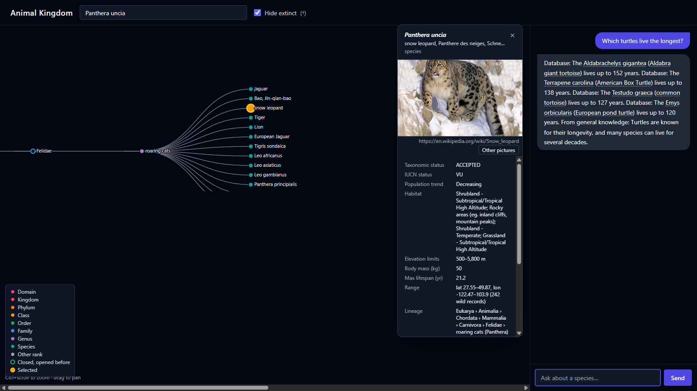
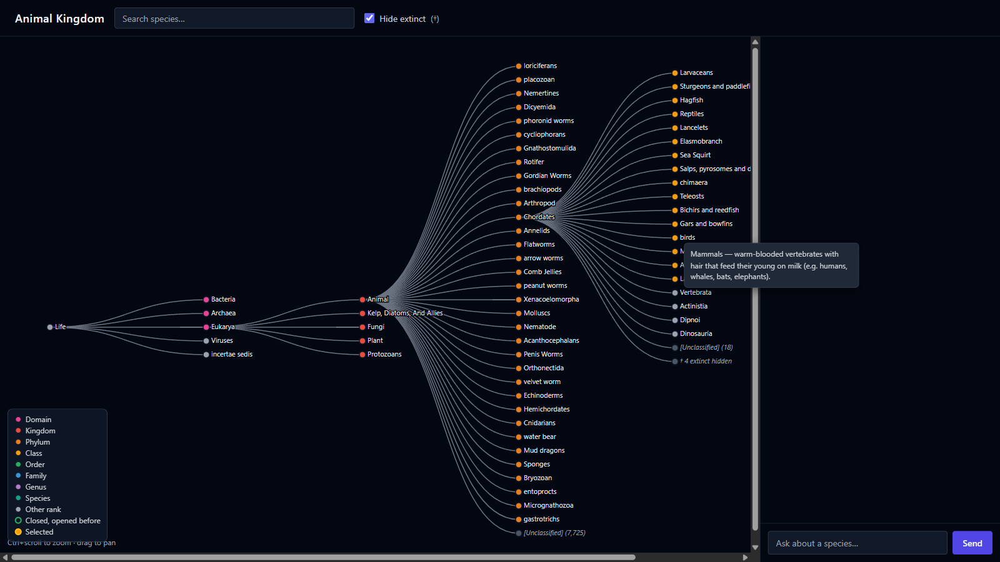
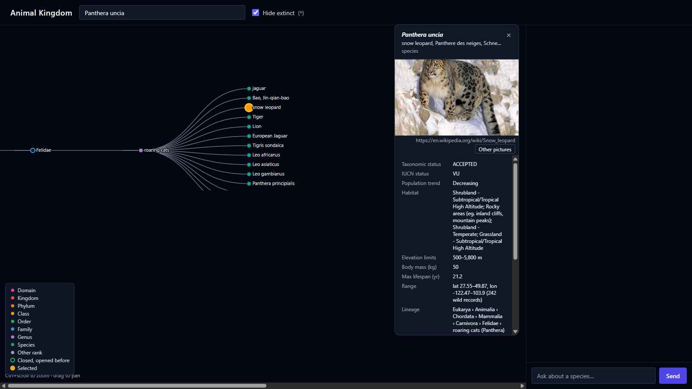

# Animal Kingdom

An offline-first desktop web app for exploring the tree of life, with a focus on its **~1.8 million animal species**. Browse the full Catalogue of Life taxonomy as a zoomable tree, open any species to see its traits, conservation status, range and photo, or ask questions in plain English to a chatbot that runs **entirely on your own machine** and answers from the species database rather than from memory.

> **Built by AI.** Every line of code, every test, the data pipeline and this documentation were written by an AI coding agent ([Claude Code](https://claude.com/claude-code), Anthropic's Claude models). A human set the goals, made the design decisions, tested each step in the browser and approved it. See [How it was built](#how-it-was-built) and the full journey in [`Docs/HISTORY.md`](Docs/HISTORY.md).



## What it does

### An explorable tree of life

Life → domains → kingdoms → phyla → classes → orders → families → genera → species. Children load lazily from SQLite as you click, so the whole tree is browsable without loading millions of nodes up front. Large groups split into A–Z letter nodes. Animal phyla, classes and orders have hover texts checked against Wikipedia; nodes show common names ("Chordates", "birds", "Teleosts") with the scientific name underneath. Extinct taxa carry a † and can be hidden with one checkbox.



### A species panel

Search by scientific, common or old name, and the tree opens along the path to the species. The panel shows its picture (with attribution, and a gallery to choose another one), IUCN Red List status and population trend, habitat, elevation, body mass, length, maximum lifespan, geographic range, lineage and a Wikipedia summary. Traits that aren't in the database yet are looked up on demand from IUCN, GBIF, Wikidata and Wikipedia, and every value records where it came from. Values the local model estimated from the Wikipedia text are marked **est.**



### A local chatbot that cites its source

A LangGraph agent on a local Ollama model (`llama3.1:8b`) answers questions by calling database tools. Some example questions:

| Question | Tool behind the answer |
|---|---|
| *Which turtles live the longest?* | ranks a group by a trait (lifespan, mass, length, range edges) |
| *Tell me about the snow leopard* | looks up one species, including the countries it lives in |
| *What animals live in Madagascar?* | species with wild GBIF records in a country, continent, island or sea |
| *How many bird species are endangered?* | counts and IUCN statistics for any group |
| *What is a pangolin related to?* | lineage, members and relatives |
| *Animals that live in caves and eat bats* | semantic search over 88,000 Wikipedia summaries (ChromaDB) |

Every sentence starts with its source: `Database:` or `From general knowledge:`. Code checks the source labels instead of trusting the model. A `Database:` sentence that isn't backed by a tool result is relabelled. An answer written without a tool call is retried. A ranking that covers only part of a group gets a coverage note ("Only 3,612 of 1,800,133 species have a recorded body mass"). Species named in the answer become links that open them in the tree.

## Tech stack and why

| Layer | Technology | Why |
|---|---|---|
| Backend API | Python 3.12, FastAPI, Uvicorn | Python has the best data and LLM libraries. FastAPI keeps the routes thin, typed and self-documenting (`/docs`), and serves the frontend too, so there is one process to run. |
| LLM | Ollama with `llama3.1:8b` | Runs locally on a consumer GPU (built on an AMD RX 7900 XTX), so nothing leaves the machine. In a scored comparison it chose the right tool 13/13 times at ~3 s per answer; a larger model was slower and less reliable with tools ([`Docs/PLAN.md`](Docs/PLAN.md), Increment 22). `AK_CHAT_MODEL` swaps it. |
| Agent | LangChain 0.3 / LangGraph 0.4 | A ReAct agent with typed tools. The model decides *which* query to run; the SQL stays in reviewed, tested code. |
| Structured data | SQLite (~3 GB, 6.1 M rows) | One file, no server, fast range queries over a `taxon_path` index; good for an offline app. |
| Semantic search | ChromaDB + `all-MiniLM-L6-v2` | A small embedding model that runs on the CPU; a local persistent store with no service to manage. |
| Frontend | HTML, Tailwind CSS, plain ES modules, D3.js v7 | No build step. D3 handles the collapsible, zoomable tree with full control over layout and transitions. |
| Tests | pytest, Vitest + Testing Library, Playwright | Unit tests on each layer plus end-to-end runs in a real browser, including live chat conversations. |

## Data sources and citations

The code is MIT-licensed (see [LICENSE](LICENSE)). **The data is not part of this repository** and remains under its own licences. If you rebuild the database, follow each source's terms:

| Source | Used for | Licence / terms |
|---|---|---|
| **Catalogue of Life**, COL26.10 XR (version 2026-10-16 XR). https://doi.org/10.48580/dgzlf | The taxonomy: names, ranks, lineage, synonyms, extinct flags | CC BY 4.0 |
| **GBIF Backbone Taxonomy** (2023). GBIF Secretariat. https://doi.org/10.15468/39omei | The earlier taxonomy; still the source for names COL lacks and for fossil (Paleobiology Database–sourced) flags | CC BY 4.0 |
| **GBIF.org** (2026) GBIF Occurrence Download https://doi.org/10.15468/dl.5v8cu8 | Geographic ranges of ~172,000 species | CC BY 4.0 (records CC0 / CC BY) |
| **GBIF.org** (2026) GBIF Occurrence Download https://doi.org/10.15468/dl.rujp2t | Countries with wild records per species | CC BY 4.0 (records CC0 / CC BY) |
| **IUCN 2026.** The IUCN Red List of Threatened Species. https://www.iucnredlist.org (API v4) | Red List status, population trend, habitat, elevation | [IUCN Terms of Use](https://www.iucnredlist.org/terms/terms-of-use): non-commercial use, attribution required, free API token |
| **AnAge**: Tacutu, R. et al. (2018) *Human Ageing Genomic Resources: new and updated databases.* Nucleic Acids Research 46(D1): D1083–D1090 | Maximum lifespan, body mass, metabolic rate | Free for research and educational use |
| **Wikipedia** (English) via the REST API | Species summaries (88,500 species), some pictures | CC BY-SA 4.0 |
| **Wikidata** | Traits and old-name (synonym) links, looked up on demand | CC0 |
| **Wikimedia Commons**, **iNaturalist**, GBIF occurrence media | Species pictures | Per image; the attribution and licence are stored with each picture and shown in the panel |
| **Natural Earth** 1:50m | Countries, continents, islands and seas for the chat's "animals of a place" | Public domain |
| **Global Names Verifier** (with WoRMS, ITIS, IRMNG, NCBI and others) | Independent checks of orders and families that COL leaves blank | Per source |

DuckDuckGo image search is the last fallback for a missing picture. Its results carry the source page as attribution.

## Building and running

### Prerequisites

- **Windows 10/11** (the scripts and paths assume Windows; the code itself is mostly portable).
- **Python 3.12** and **Node.js 24+** (Node only for the tests).
- **Ollama** with the model pulled: `ollama pull llama3.1:8b`. A GPU with 8 GB+ VRAM helps; the CPU works too, just more slowly.
- About **15 GB of disk** while building (the final database is ~3 GB), plus the source downloads.

### Install

```bash
git clone <this repository>
cd animal-kingdom
py -3.12 -m venv .venv
.venv\Scripts\activate

# PyTorch first (CPU wheels are enough for the embedding model)
pip install torch --index-url https://download.pytorch.org/whl/cpu
pip install -r backend/requirements.txt

# Test tooling (optional)
npm install                 # Playwright
cd frontend && npm install  # Vitest
```

### Configure

| Variable | Default | Purpose |
|---|---|---|
| `SPECIES_DB_PATH` | `E:\AnimalKingdomSystem\species.db` | The SQLite database |
| `CHROMA_DB_PATH` | `E:\AnimalKingdomSystem\chroma_db` | The vector store |
| `AK_PORT` | `8000` (`8010` in `start.bat`) | Backend port |
| `AK_CHAT_MODEL` | `llama3.1:8b` | Any Ollama chat model with tool support |
| `IUCN_API_TOKEN` | none | Free token from https://api.iucnredlist.org; also read from a `.env` file in the project root |
| `AK_CONTACT_EMAIL` | `add-your-email@example.com` | **Set this to your own address before running the data scripts.** Wikimedia, GBIF and AnAge ask API clients for a contact in the User-Agent and may throttle or block anonymous ones. |

`.env` is git-ignored. Never commit your token or your address.

### Build the database

The database is built once by the scripts in [`data/`](data/). Most of them resume from a checkpoint if interrupted. Several scripts still have the author's data folder `E:\AnimalKingdomSystem\` as a constant at the top; change it if you use another location. The order in which the database was built:

1. **Taxonomy.** `import_gbif.py --download` imports the GBIF Backbone. `import_col.py` loads the Catalogue of Life ColDP archive into its own database. `verify_col_levels.py` checks blank orders and families against independent sources (resumable, several hours). `build_col_db.py` builds the final `species` table, carrying over what the GBIF database collected.
2. **Tidy-ups after a build.** `backfill_extinct.py --rollup-only` and `fix_common_names.py`.
3. **Enrichment.** `enrich_iucn.py` (needs the token), `enrich_anage.py`, `enrich_wikipedia.py --animals-only` (about 1.3 s per species, days for all of them), `enrich_images.py`.
4. **Places.** `build_places.py` (Natural Earth GeoJSON). Then `import_gbif_ranges.py` and `import_gbif_countries.py`, which read GBIF SQL downloads you request with a free GBIF account.
5. **Semantic index.** `build_embeddings.py` embeds the Wikipedia summaries into ChromaDB.

The app works with a partly enriched database: missing traits and pictures are fetched on demand when you open a species.

### Run

```bash
start.bat                     # starts the backend on :8010 and opens the browser; stop.bat stops it
python manage.py start        # same, on AK_PORT (default 8000); also: status, stop
```

For development: `cd backend` then `..\.venv\Scripts\python -m uvicorn app.main:app --reload --port 8010`. The API is documented at http://localhost:8010/docs.

### Test

```bash
cd backend  && ..\.venv\Scripts\python -m pytest tests/ -v   # backend
cd frontend && npm run test                                  # frontend (Vitest)
set AK_PORT=8010 && npx playwright test                      # end-to-end; chat specs need Ollama
```

## How it was built

The project was developed by an AI agent in **33 increments** and 200+ commits, in two bursts: June 6–11 and November 3–14, 2026. Each increment followed the same loop: plan it in [`Docs/PLAN.md`](Docs/PLAN.md), write the tests first, implement, review, have the human test it in the browser, then record the decisions and commit. Bugs that the human reported from screenshots were traced to a root cause before anything was fixed.

Milestones: a GBIF-based tree and species panel, then a local chat with tools, then a full switch of the taxonomy to the Catalogue of Life. After that came verified source labels in the chat, ranges and countries from GBIF downloads, and picture handling. The complete road, with the decisions and dead ends along the way, is in **[`Docs/HISTORY.md`](Docs/HISTORY.md)**.

## Project layout

```
backend/app/     FastAPI routes (main.py), SQLite helpers, chat agent and tools, trait and image lookups
backend/tests/   pytest suite
frontend/        index.html, css/, js/ (tree, panel, chat, traits, images)
frontend/tests/  Vitest suite
e2e/             Playwright specs
data/            import, enrichment and evaluation scripts
Docs/            PLAN.md (build log), HISTORY.md, Manual.md (user guide), DB_SCHEMA.md
manage.py        service manager behind start.bat / stop.bat
```

## Documentation

- [`Docs/Manual.md`](Docs/Manual.md): user manual
- [`Docs/DB_SCHEMA.md`](Docs/DB_SCHEMA.md): database schema
- [`Docs/PLAN.md`](Docs/PLAN.md): the build plan, increment by increment, with the decisions behind each step
- [`Docs/HISTORY.md`](Docs/HISTORY.md): how the project got here
- [`CLAUDE.md`](CLAUDE.md): the working instructions the AI agent followed

## Licence

The code is released under the [MIT licence](LICENSE). Data from the sources above stays under their own licences and is not included in this repository.
